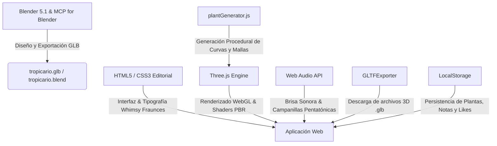

# Tropicario — Jardín Botánico Colectivo 3D
**Proyecto de Interacción 3D y Creatividad Generativa**  
*Materia: Inteligencia Artificial Generativa / Juego en Clase*  
*Autor: Juanita Martínez*

---

## 1. Resumen del Proyecto

**Tropicario** es una aplicación web interactiva en 3D concebida como un jardín botánico virtual colectivo bajo un gran invernadero acristalado. El proyecto combina la contemplación serena de un ecosistema en constante crecimiento con un taller generativo 3D donde cualquier usuario puede diseñar, bautizar y sembrar su propia especie vegetal imaginaria.

El espacio no es un fondo blanco abstracto: está ambientado dentro de una arquitectura botánica delicada con cúpula de cristal transparente, cielo exterior visible, luz natural suave, senderos de arenisca y parcelas de tierra fértil donde las plantas de los usuarios son las protagonistas.

---

## 2. Características e Interacciones Implementadas

### A. Exploración Inmersiva del Invernadero 3D
* **Arquitectura botánica completa:** Bóveda de cristal translúcido con vigas metálicas ligeras, portal de acceso de piedra y vegetación perimetral suave que acompaña sin competir con las plantas.
* **Cámara de recorrido suave:** Controles orbitales intuitivos con mouse y teclado (arrastrar para rotar, rueda para zoom, paneo) y atajos de cámara preestablecidos (**Entrada**, **Plaza Central** y **Vista Aérea**).
* **Brisa ambiental:** Las plantas se mecen de forma orgánica y fluida con un ciclo de oscilación procedural.

### B. Ciclos Horarios y Atmósferas Dinámicas
Permite alternar entre tres momentos del día en tiempo real:
1. **☀️ Mediodía:** Luz natural diurna clara, sombras difusas y cielo celeste despejado.
2. **🌅 Ocaso Dorado:** Iluminación cálida con tonos ámbar, sombras alargadas y resplandor cobrizo en los cristales.
3. **🌙 Noche Bioluminiscente:** Cielo azul nocturno profundo con luz de luna tenue, enjambres de **luciérnagas tridimensionales flotantes** y flores que brillan con **bioluminiscencia e intensidad emisiva mágica**.

### C. Audio Ambiental Procedural (Web Audio API)
* Síntesis sonora en tiempo real sin dependencias externas:
  * Generador de **brisa de viento suave** mediante ruido rosa filtrado por resonancia y modulado por un LFO lento.
  * **Campanillas botánicas de cristal** sintetizadas en escala pentatónica relajante que resuenan de forma orgánica a intervalos aleatorios.
  * Botón discreto de activación/silencio (`🔈 / 🔊`) en la barra superior.

### D. Taller Botánico 3D (Editor de Especies)
Un creador tridimensional orbital en 360° con controles en tiempo real y renderizado fotorrealista sólido:
* **Morfologías de Tallo Botánico (7 tipos):**
  1. *Voluble espiral:* Tirabuzón dinámico con zarcillos vivos.
  2. *Arbusto leñoso:* Tronco ramificado en 4 copas divergentes y flores secundarias.
  3. *Escapo erguido:* Tallo esbelto simple con conicidad natural.
  4. *Suculento acanalado:* Columna carnosa con 6 costillas botánicas y espinas.
  5. *Nudoso (Bambú):* Articulaciones y anillos nodales ensanchados.
  6. *Sinuoso flexuoso:* Curvaturas orgánicas en S natural.
  7. *Roseta basal:* Corona de hojas carnosas en espiral áurea con escapo floral emergente.
* **Estructuras de tallo:** Opciones para corteza lisa, espinas/acúleos orgánicos o zarcillos trepadores elásticos.
* **Follaje:** Hojas 3D con concavidad transversal y caída natural por gravedad (cinta, oval, abanico).
* **Floración multicapa:** 1 a 4 capas concéntricas de pétalos rizados con ondulaciones orgánicas (loto, orquídea, corona, campana, estrella) y centros florales auténticos (corona de pistilos y anteras doradas, roseta interior, espádice curvado de lirio, rocío matutino).
* **Materiales Táctiles Sólidos (CERO transparencia fantasma):** Acabados *Aterciopelado (sheen)*, *Satinado ceroso (cutícula tropical)*, *Mate celulósico* y *Nácar botánico*, enriquecidos con gradientes de color por vértice (*Vertex Colors*) y sombras suaves PCF.
* **Exportación 3D directa:** Descarga de la planta modelada en formato **`.glb` estándar** para abrir en Blender o imprimir en 3D.

### E. Dimensión Colectiva, Social y Persistencia
* **Ficha Botánica:** Al hacer clic sobre cualquier espécimen en el jardín, la cámara hace una transición suave hacia él y despliega su ficha con nombre científico/común, autor, fecha, morfología y descripción poética.
* **Notas de campo:** Sistema de comentarios colaborativos donde cada visitante puede dejar observaciones botánicas en la ficha de cada planta.
* **Reacciones:** Contador interactivo de "Me gusta" y guardado de "Favoritas".
* **Persistencia:** Todas las especies sembradas, comentarios y reacciones se almacenan automáticamente en el navegador (`localStorage`) para persistir entre sesiones.

---

## 3. Arquitectura Técnica



* **Frontend:** HTML5 semántico + CSS3 puro con variables y estética editorial contemporánea.
* **Tipografías:** *Fraunces* (estilo whimsy, orgánico y curvilíneo) + *Plus Jakarta Sans* (interfaz legible y neutra).
* **Motor 3D:** Three.js r128 (WebGLRenderer con mapeo de tonos ACESFilmic, sombras suaves PCFSoftShadowMap, materiales MeshPhysicalMaterial y MeshStandardMaterial).
* **Exportación 3D:** Three.js `GLTFExporter` en formato binario (`.glb`).
* **Audio:** Web Audio API nativo (AudioContext, BiquadFilterNode, OscillatorNode, GainNode).

---

## 4. Estructura de Archivos

| Archivo | Descripción |
| :--- | :--- |
| **`index.html`** | Estructura semántica, visor 3D, HUD superior, ficha botánica y modal del taller. |
| **`styles.css`** | Estilos visuales editoriales, paleta blanco cálido y verde profundo, modo noche y animaciones. |
| **`plantGenerator.js`** | Motor procedural de geometría botánica 3D (tubos Catmull-Rom, pétalos y hojas Bézier). |
| **`app.js`** | Lógica central Three.js: arquitectura del invernadero, iluminación, raycasting, audio y persistencia. |
| **`tropicario.glb`** | Modelo 3D del invernadero exportado desde Blender. |
| **`tropicario.blend`** | Archivo maestro de la escena en Blender 5.1. |
| **`PROYECTO.md`** | Documento conceptual con los 6 puntos de definición inicial. |
| **`ENTREGA.md`** | Este documento de entrega y documentación técnica. |

---

## 5. Cómo Ejecutar la Aplicación

1. En la terminal, sitúate en la carpeta del proyecto:
   ```bash
   cd /Users/juanitamartinez/Documents/IAG/Juego_Enclase
   ```
2. Inicia un servidor web local (por ejemplo con Python):
   ```bash
   python3 -m http.server 8080
   ```
3. Abre tu navegador en:
   **[http://localhost:8080](http://localhost:8080)**
